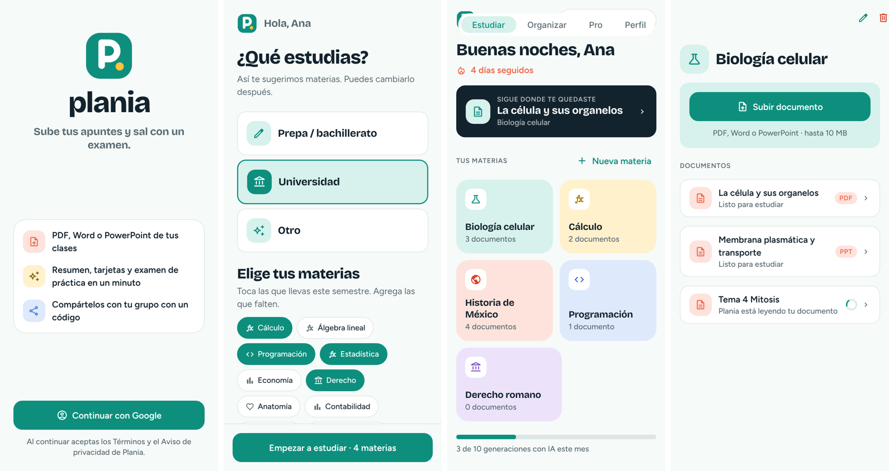
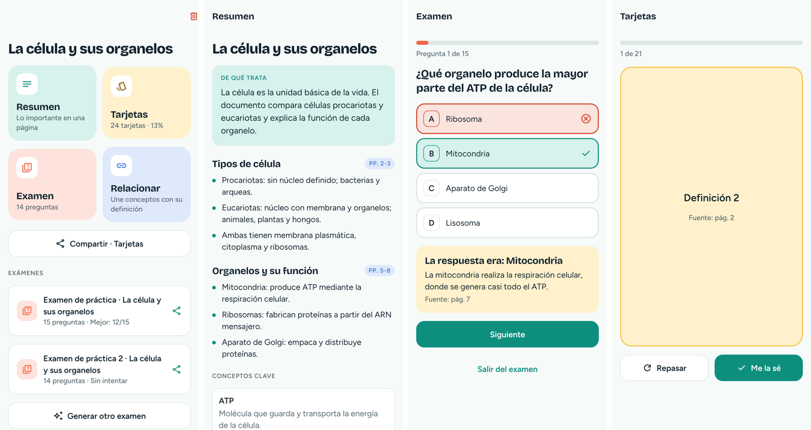
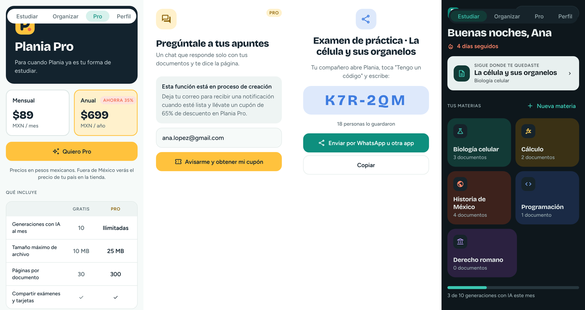

# Plania

**Sube tus apuntes y sal con un examen.** App de estudio de RemakeNet para estudiantes de prepa y universidad (15 a 25 años). Se lanza en México y estará disponible en toda América, en español e inglés.

El alumno organiza sus materias, sube un PDF, Word o PowerPoint y Plania le prepara:

- **Resumen** por temas, con la página de donde sale cada punto
- **Tarjetas de memoria** con repaso espaciado
- **Examen de práctica** con explicación y fuente de cada respuesta, y la opción de generar otro distinto
- **Relacionar**: actividad para unir conceptos con su definición

Los exámenes y tarjetas se comparten con un código de 6 letras ("Tengo un código").

Las funciones Pro que todavía no existen muestran "Esta función está en proceso de creación" y piden el correo a cambio de un cupón de 65%. El organizador (notas, ideas, proyectos, eventos) queda en segundo plano por ahora, con su propia lista de espera.

## Estructura

```
src/
  app/                 Pantallas (Expo Router: cada archivo es una ruta)
    (tabs)/            Estudiar · Organizar · Pro · Perfil
    subject/           Materia y formulario de materia
    document/          Documento y sus herramientas
    study/             Resumen, tarjetas, examen, relacionar
    share/ code.tsx    Compartir y "Tengo un código"
    waitlist/          Lista de espera con cupón
  components/          Logo, íconos y piezas de interfaz
  lib/                 Supabase, inicio de sesión, datos, planes, pagos (preparado)
  locales/             Textos en español e inglés
supabase/
  migrations/          Tablas, seguridad por usuario, cupones, códigos para compartir
  functions/           Servidor: procesar documentos con IA, borrar cuenta, webhook de pagos
```

## Tecnología

- **App:** Expo SDK 58 + React Native, Expo Router, TanStack Query, i18next
- **Cuentas y datos:** Supabase (Postgres con seguridad por fila, Storage, Edge Functions)
- **Inicio de sesión:** Google, nativo en Android e iOS
- **IA:** API de Claude (Anthropic) desde el servidor; la llave nunca llega al celular
- **Pagos (preparado):** RevenueCat para App Store y Google Play

## Empezar

Lee **[SETUP.md](SETUP.md)**: explica cómo conectar Supabase, Google y Anthropic, y cómo probar la app en tu celular.

```bash
npm install
npm run typecheck
npm run lint
```

## Pantallas

Capturas de la versión web con datos de ejemplo. En el celular, las pestañas van abajo.




